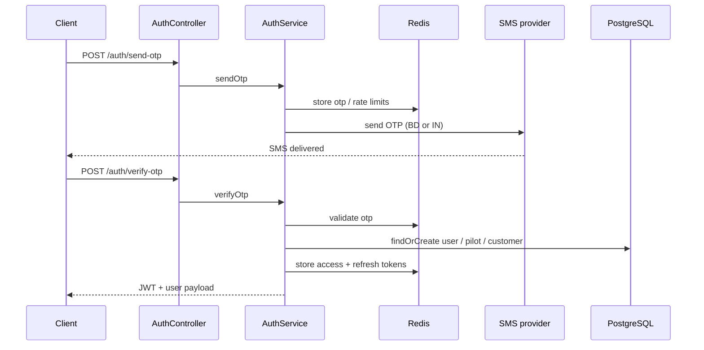
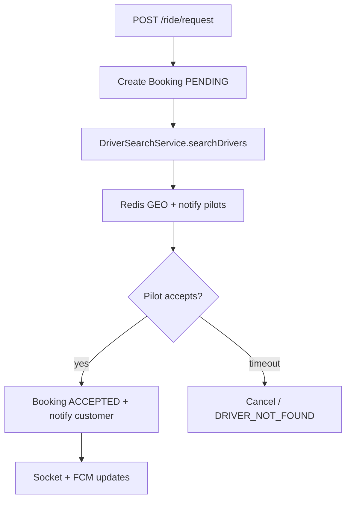
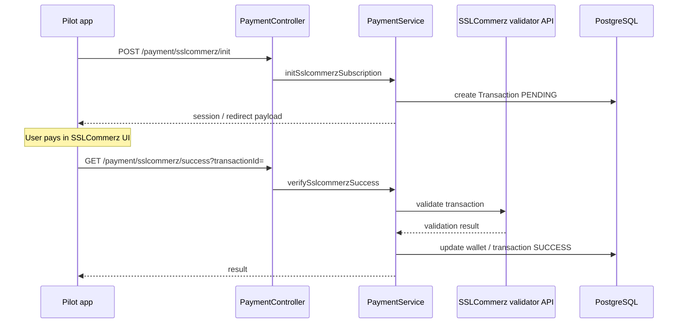
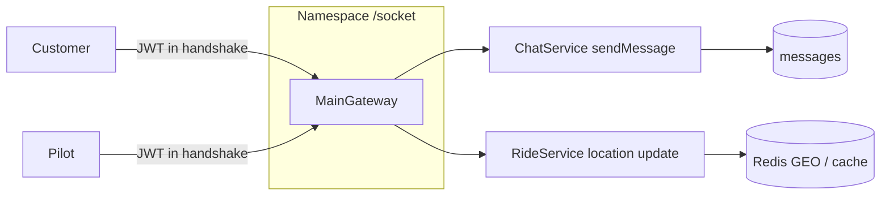

# End-to-end flows (Mermaid)

These diagrams are **approximate** and meant for onboarding. For exact branching and error paths, read the referenced services.

---

## 1. Phone auth (OTP → JWT)

Typical path: `AuthService.sendOtp` → `verifyOtp` → Redis session + Prisma user.

**Related code:** `src/modules/auth/auth.service.ts`, `src/core/utils/otp.util.ts`.

---

## 2. Ride request → driver search → accept

High-level only; `DriverSearchService` uses Redis pub/sub, GEO, and iteration config.

**Related code:** `src/modules/ride/ride.service.ts`, `src/modules/ride/services/driver-search.service.ts`, `src/modules/ride/services/ride-notification.service.ts`.

---

## 3. SSLCommerz subscription payment (app-driven callbacks)

The mobile client completes checkout, then calls the API with the **same authenticated session** (Bearer JWT). Server validates with SSLCommerz validator APIs.

**Related code:** `src/modules/payment/payment.service.ts`, `src/modules/payment/payment.controller.ts`.

---

## 4. Realtime: chat or live location

Both use the same Socket.IO server; JWT is validated on connect (`SocketService` + Redis token check).

**Related code:** `src/core/socket/main.gateway.ts`, `src/core/socket/socket.service.ts`.
