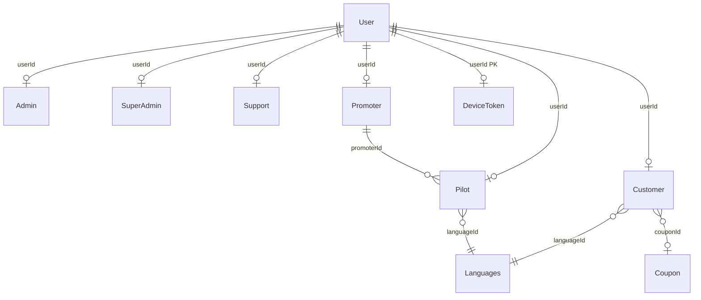
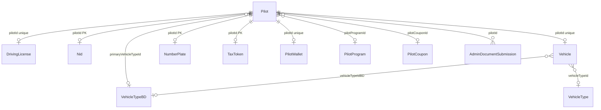
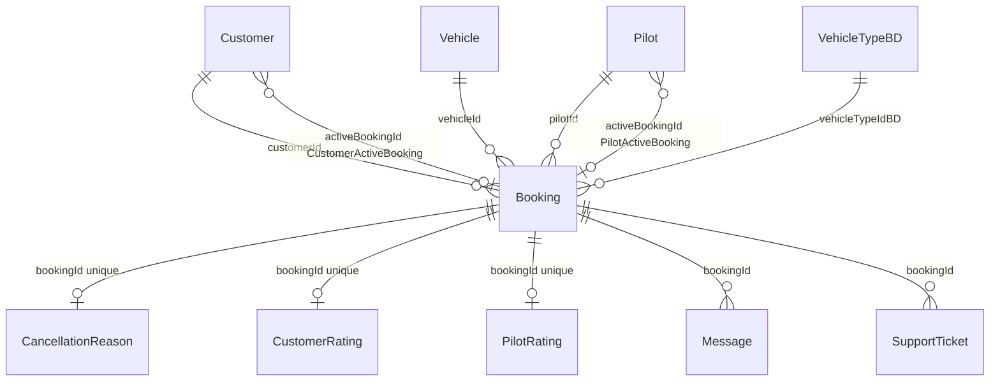
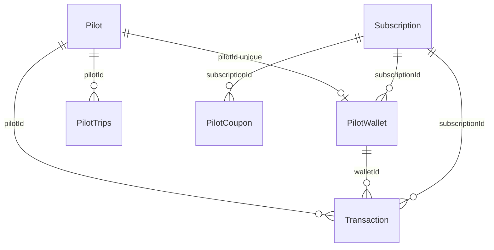
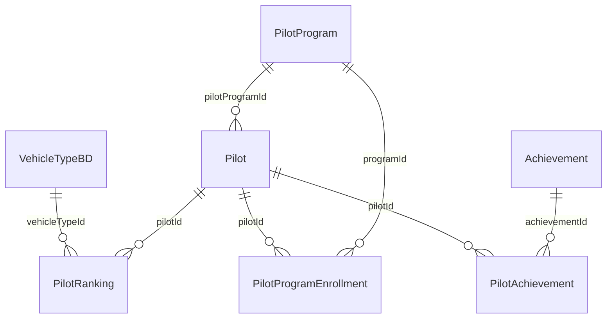
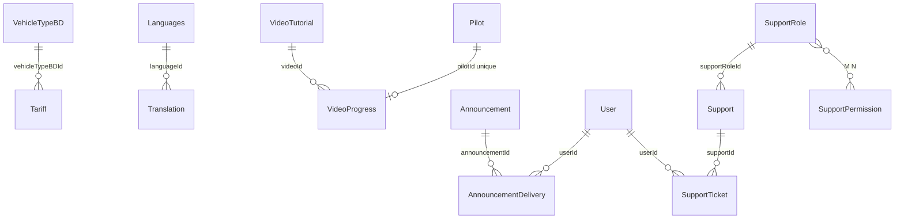
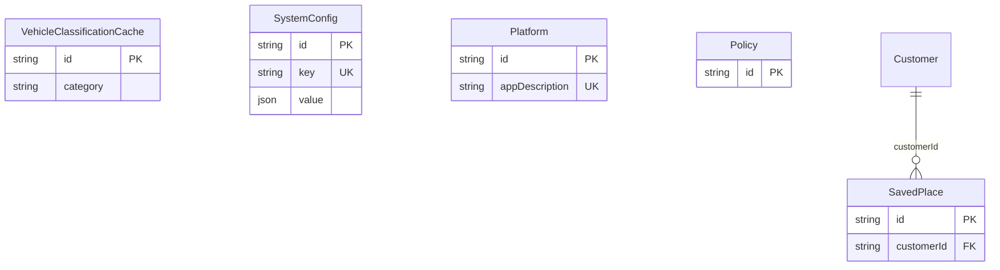

# ER diagrams (from Prisma schema)

Source: `prisma/schema.prisma`. Diagrams are **simplified views** (not every column). All models use a UUID `id` primary key unless noted.

---

## 1. Identity and roles

One `User` row per login identity; role-specific profile is 1:1.

---

## 2. Pilot onboarding and vehicle

---

## 3. Bookings and ride lifecycle

---

## 4. Wallet, trips, and subscriptions

---

## 5. Programs, rankings, achievements

---

## 6. Tariffs, i18n, and misc

---

## 7. Caching / auxiliary

