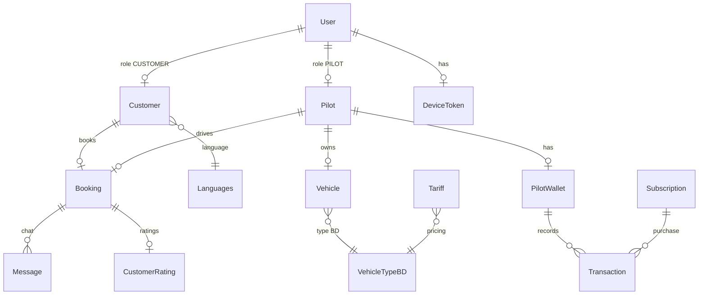

# Data model overview

**Canonical schema:** [`schema.prisma`](../../prisma/schema.prisma) — run `prisma migrate` and `prisma generate` after changes.

This page gives a **compact ER-style view** of how the main domain fits together. Not every field or table is shown.

---

## Entity relationship (core domain)

---

## Model index (from Prisma)

Use this as a **checklist** when searching the codebase; see `schema.prisma` for fields and relations.

| Area | Models |
|------|--------|
| Identity / staff | `User`, `SuperAdmin`, `Admin`, `Support`, `SupportRole`, `SupportPermission`, `Promoter` |
| Apps | `Customer`, `Pilot`, `DeviceToken`, `Coupon`, `SavedPlace` |
| Pilot KYC / fleet | `DrivingLicense`, `Nid`, `Vehicle`, `VehicleType`, `VehicleTypeBD`, `NumberPlate`, `TaxToken`, `VehicleClassificationCache` |
| Money | `PilotWallet`, `Transaction`, `Subscription`, `PilotCoupon`, `Tariff` |
| Trips | `Booking`, `PilotTrips`, `CancellationReason`, `CustomerRating`, `PilotRating` |
| Comms | `Message`, `Languages`, `Translation` |
| Programs | `PilotProgram`, `PilotProgramEnrollment`, `PilotRanking`, `Achievement`, `PilotAchievement` |
| Ops | `AdminDocumentSubmission`, `SupportTicket`, `SystemConfig`, `Platform`, `Policy` |
| Content | `VideoTutorial`, `VideoProgress`, `Announcement`, `AnnouncementDelivery` |

---

## Operational notes

- **Enums** (`UserRole`, `BookingStatus`, `UserStatus`, etc.) are defined in `schema.prisma` and drive guards and business logic.
- **Indexes** — see `@@index` / `@unique` in the schema for query hot paths (e.g. `DeviceToken.fcmToken`, bookings by status).
